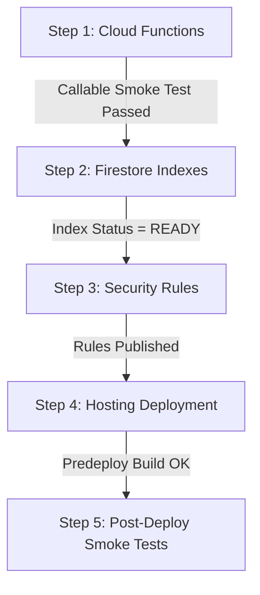

# Spenza 💸

> Fast, insight-driven personal expense tracker — built for one person, designed for clarity.

Spenza is a **PWA** (installable on desktop & mobile) that answers *"where is my money actually going?"* at a glance. It supports manual expense entry, split settlements and recoverable tracking, recurring subscriptions, trip budgets, monthly budgets, AI-style insights, and bulk import from Excel/CSV — backed by Firebase with offline support and trusted server-side Cloud Functions execution.

---

## Features

| Area | What it does |
|------|-------------|
| **Dashboard** | Monthly summary, 6-month trend chart, category breakdown, biggest expenses, micro-spend stats, payment-mode donut, upcoming recurring reminders |
| **Transactions** | Add/edit/delete expenses with category, payment mode, bank account, trip tag, recoverable amounts and splits; infinite-scroll list grouped by date |
| **Categories** | Full CRUD — rename, reorder, archive; pre-seeded with default categories |
| **Payment Accounts** | Manage your banks, UPI apps, cards; seeded on first login; strict mode enforcement |
| **Trips** | First-class trip tracking — attach expenses to a trip, view per-trip totals, day-by-day breakdown, payment breakdown, budget progress |
| **Recurring** | Track subscriptions/EMIs; due-today prompts across the app; log or skip occurrences with composite-index-backed queries |
| **Budgets** | Set a monthly total + per-category budget; copy from previous month; live progress bars |
| **Insights** | 8 computed metrics, year-over-year comparison bar chart, auto-generated plain-English insight; 7-day Firestore cache |
| **Import** | Bulk import from `.xlsx` or `.csv`; auto-detect month/trip sheets; category bulk-review; duplicate detection; server-executed trusted v2 imports with atomic cursor |
| **PWA** | Installable, offline-capable (Workbox + IndexedDB persistence); offline banner |
| **Export** | One-click CSV export of all transactions with split metadata |
| **Auth** | Google Sign-In; all data strictly isolated per UID under `users/{uid}/` |

---

## Tech Stack

| Layer | Technology | Version / Notes |
|-------|-----------|-----------------|
| **Frontend Framework** | React + TypeScript + Vite | React 19, TypeScript 6, Vite 8 |
| **Styling** | Tailwind CSS + CSS Design Tokens | Tailwind CSS v4 (`@tailwindcss/vite`), custom design tokens in `src/index.css` |
| **Routing** | React Router | React Router v7 |
| **Client Backend SDK** | Firebase Web SDK | Firebase 12 (Auth, Firestore, Storage, Functions) |
| **Cloud Functions** | Firebase Functions + Admin SDK | Node.js 22 runtime, `firebase-functions` v7, `firebase-admin` v13 |
| **Charts** | Recharts | Recharts 3 |
| **Icons & UI** | Lucide React + Radix UI | Lucide React, Radix UI primitives |
| **Dates & Formats** | date-fns + custom formatters | UTC-safe recurring date handling, integer paise currency formatting |
| **Spreadsheet Parsing** | SheetJS (xlsx) | Multi-sheet Excel workbook and CSV parsing |
| **PWA & Offline** | vite-plugin-pwa + Workbox | IndexedDB offline persistence via Firestore `persistentLocalCache` |
| **Validation** | Zod + React Hook Form | Zod 4 runtime schemas, React Hook Form 7 |
| **Linter** | oxlint | Fast Rust-based linter |

---

## Prerequisites

Before setting up or deploying Spenza, ensure your environment meets the following requirements:

1. **Node.js**: **Node.js 22 LTS** is required.
   - Firebase Functions uses runtime `"nodejs22"` (`functions/package.json` specifies `"engines": { "node": "22" }`).
   - Verify: `node -v` (should output `v22.x.x`).
2. **npm**: **npm 10+** (bundled with Node 22).
3. **Firebase CLI**: Install globally via `npm install -g firebase-tools`.
   - Verify: `firebase --version`.
4. **Java Runtime (Optional / Emulator Testing)**: **Java 11+ (JRE or JDK)** is required only if running the Firebase Local Emulator Suite (`firebase emulators:start`).

---

## Environment Variables Configuration

Spenza uses environment variables prefixed with `VITE_` to initialize the Firebase Client SDK.

> ⚠️ **Important Build-Time Inlining**: Vite statically inlines `VITE_*` variables into the production client bundle at build time (`npm run build`). Updating environment variables in `.env.local` or switching Firebase projects requires rebuilding the frontend before deploying to Hosting.

### 1. Setup Local Environment File

```bash
cp .env.example .env.local
```

### 2. Required Variables

| Variable | Description | Example / Target |
|----------|-------------|------------------|
| `VITE_FIREBASE_API_KEY` | Firebase Web API key | `AIzaSy...` |
| `VITE_FIREBASE_AUTH_DOMAIN` | Firebase Auth domain | `<project-id>.firebaseapp.com` |
| `VITE_FIREBASE_PROJECT_ID` | Firebase Project ID | e.g. `spenza-90037` |
| `VITE_FIREBASE_STORAGE_BUCKET` | Cloud Storage bucket | `<project-id>.firebasestorage.app` |
| `VITE_FIREBASE_MESSAGING_SENDER_ID` | FCM messaging sender ID | `123456789012` |
| `VITE_FIREBASE_APP_ID` | Firebase Web App ID | `1:123456789012:web:...` |

> 🔒 **Security Notice**: Never commit `.env.local` or real credentials to Git. `.env.local` is listed in `.gitignore`. Use `.env.example` as a template.

---

## Local Development & Testing

### 1. Install Dependencies

```bash
npm install
npm --prefix functions install
```

### 2. Run Typechecks & Linting

```bash
# Check both TypeScript projects without writing build artifacts
node node_modules/typescript/bin/tsc -p tsconfig.app.json --noEmit --incremental false
node node_modules/typescript/bin/tsc -p tsconfig.node.json --noEmit --incremental false

# Functions typecheck
npm --prefix functions run typecheck

# Run linter
npm run lint
```

### 3. Build Locally

```bash
# Frontend production build (outputs to dist/)
npm run build

# Functions build (outputs to functions/lib/)
npm --prefix functions run build
```

### 4. Run Unit Tests

```bash
# Run all frontend unit tests (PowerShell)
$testPaths = @(Get-ChildItem -Recurse -Path src -Filter '*.test.ts' | Select-Object -ExpandProperty FullName)
node --experimental-strip-types --test $testPaths

# Run all Cloud Functions unit tests
npm --prefix functions test
```

### 5. Run Firebase Emulator Tests

Four specialized test suites verify callable security, atomic import execution, Firestore security rules, and recurring composite indexes against isolated emulator instances:

1. `functions/test/callable.emulator.test.ts` (Auth + Functions + Firestore)
2. `functions/test/importExecutor.emulator.test.ts` (Admin SDK + Firestore emulator)
3. `src/services/__tests__/importRules.emulator.test.ts` (Security rules + client SDK)
4. `src/services/__tests__/recurringIndex.emulator.test.ts` (Recurring composite query against Firestore emulator)

#### Steps to Execute Emulator Tests:

1. Build the functions codebase:
   ```bash
   npm --prefix functions run build
   ```
2. Start the Firebase emulators with an isolated demo project:
   ```bash
   firebase emulators:start --only auth,firestore,functions --project demo-spenza-test
   ```
3. Set the test environment flags in a separate terminal:
   - **PowerShell**:
     ```powershell
     $env:SPENZA_FIRESTORE_EMULATOR_HOST = "127.0.0.1:8080"
     $env:SPENZA_CALLABLE_EMULATORS = "1"
     ```
   - **Bash**:
     ```bash
     export SPENZA_FIRESTORE_EMULATOR_HOST="127.0.0.1:8080"
     export SPENZA_CALLABLE_EMULATORS="1"
     ```
4. Run the emulator test files:
   ```bash
   node --experimental-strip-types --test functions/test/callable.emulator.test.ts
   node --experimental-strip-types --test functions/test/importExecutor.emulator.test.ts
   node --experimental-strip-types --test src/services/__tests__/importRules.emulator.test.ts
   node --experimental-strip-types --test src/services/__tests__/recurringIndex.emulator.test.ts
   ```
5. Clear environment variables after test completion:
   - **PowerShell**:
     ```powershell
     Remove-Item Env:SPENZA_FIRESTORE_EMULATOR_HOST
     Remove-Item Env:SPENZA_CALLABLE_EMULATORS
     ```
   - **Bash**:
     ```bash
     unset SPENZA_FIRESTORE_EMULATOR_HOST SPENZA_CALLABLE_EMULATORS
     ```

---

## Safe Staging Environment Setup

The repository comes configured with a production Firebase alias (`prod` in `.firebaserc`). Before shipping updates to production, deploy and verify all changes in an isolated staging project.

### Staging Rules & Safeguards

- **Never modify the existing `prod` alias**: The `.firebaserc` file maintains `"prod": "spenza-90037"`. Do not change or overwrite this alias.
- **Do not invent project IDs**: Use your real staging Firebase project ID when adding the alias.
- **Strict Environment Isolation**:
  - Keep separate configuration files for staging and production (e.g. `.env.staging` and `.env.production`).
  - When preparing a build for staging, copy `.env.staging` to `.env.local` before building.
  - When preparing a build for production, copy `.env.production` to `.env.local` before building.
  - **Always check the active target** before deploying:
    ```bash
    firebase use
    ```
    Ensure the active project matches the project ID specified in `.env.local`.

### Configuring the Staging Firebase Project

1. In the [Firebase Console](https://console.firebase.google.com/), create a new Firebase project (e.g., `spenza-staging`).
2. **Authentication**:
   - Enable **Google Sign-In**.
   - Under **Authorized Domains**, add `localhost` and your staging hosting domain (`<staging-project-id>.web.app`).
3. **Cloud Firestore**:
   - Create database in **Production Mode**.
4. **Firebase Storage**:
   - Enable Storage with default bucket configuration.
5. **Cloud Functions**:
   - Upgrade the project to the **Blaze (pay as you go)** plan. Blaze is required by Google Cloud to deploy Node 22 Cloud Functions. Set a budget alert (e.g. ₹100 / $1) to prevent unintended charges.
6. Register a Web App in the staging project and record the config parameters into `.env.staging`.
7. Add the staging alias to your local Firebase CLI:
   ```bash
   firebase use --add
   # Select your staging project and name the alias "staging"
   ```
   This updates `.firebaserc` with `"staging": "<your-staging-project-id>"`.

---

## Staged Deployment Rollout

Deploying Spenza safely requires a staged rollout. Deploying components in the wrong order can cause runtime failures (e.g., deploying Hosting before Cloud Functions will break imports, or deploying Hosting before Firestore indexes will cause recurring queries to throw `FAILED_PRECONDITION`).

Follow this exact 5-step sequence:



---

### Step 1: Deploy Cloud Functions

Deploy trusted backend callable functions first so client requests never encounter missing endpoints.

```bash
# 1. Select target environment
firebase use staging   # or firebase use prod

# 2. Deploy functions
firebase deploy --only functions
```

*Note: `firebase.json` automatically runs the predeploy build hook `npm --prefix functions run build` before deploying.*

#### Verification / Smoke Test:
Verify the callable function is deployed and reachable. Send an unauthenticated POST request to the callable endpoint:
```bash
curl -X POST -H "Content-Type: application/json" -d '{"data":{}}' \
  https://us-central1-<project-id>.cloudfunctions.net/executeImportV2
```
Expected response: HTTP 401 or `{ "error": { "status": "UNAUTHENTICATED", "message": "Sign in before importing." } }`.
Confirming this error response proves the function runtime is alive and responding, without triggering any backend writes.

---

### Step 2: Deploy Firestore Indexes

Deploy database composite indexes next. Spenza requires a composite index on the `recurring` collection group:
- Collection Group: `recurring`
- Fields: `isActive` (ASCENDING), `nextDueDate` (ASCENDING)
- Query scope: `COLLECTION`

```bash
firebase deploy --only firestore:indexes
```

#### Verification:
1. Open the [Firebase Console](https://console.firebase.google.com/) → **Cloud Firestore** → **Indexes** tab.
2. Locate the composite index for `recurring`.
3. **Wait until the index status is `READY` (or `ENABLED`).**
   - When first deployed, the index status will be `BUILDING`. Building can take 2 to 10 minutes depending on database size.
   - You can also check index status via Google Cloud CLI:
     ```bash
     gcloud firestore indexes composite list --project=<project-id>
     ```

> ⚠️ **CRITICAL WARNING**: **Do not assume index deployment is verified merely because emulator tests passed!**
> The Firebase Local Emulator Suite creates composite indexes in-memory on demand and does not replicate production Firestore's strict index requirement. In production, queries in `useRecurringCheck` and `getDueRecurringTransactions` will **immediately crash with `FAILED_PRECONDITION`** if the client is deployed before the index is `READY`.

---

### Step 3: Deploy Firestore & Storage Security Rules

Deploy the locked-down security rules:

```bash
firebase deploy --only firestore:rules,storage
```

#### Verification:
Confirm Firebase CLI outputs:
- `✔  firestore: released rules firestore.rules to cloud.firestore`
- `✔  storage: released rules storage.rules to firebase.storage`

---

### Step 4: Deploy Hosting (with Protected Predeploy Build)

Once Functions, Indexes, and Rules are healthy, deploy the static frontend.

`firebase.json` includes an automatic hosting predeploy build hook:
```json
"hosting": {
  "public": "dist",
  "predeploy": [
    "npm run build"
  ]
}
```

This guarantees:
1. The frontend bundle is freshly compiled with the correct environment variables.
2. Any TypeScript error (`tsc -b`) or bundling error immediately terminates deployment with non-zero exit code.
3. Stale assets in `dist/` are never deployed.

#### Deployment Command:
```bash
# 1. Ensure .env.local matches active target project
# 2. Deploy hosting
firebase deploy --only hosting
```

---

### Step 5: Post-Deployment Smoke Tests

Perform an end-to-end sanity check on the deployed app URL:

1. **Authentication**:
   - Visit the hosting URL in a fresh browser session.
   - Sign in with Google.
   - Confirm successful redirect to `/app/dashboard` and that user data is created under `users/{uid}/`.
2. **Transactions & Ledger Integrity**:
   - Add a test expense with ₹100.50.
   - Verify integer paise storage (`10050` paise) in Firestore Console.
   - Verify payment account constraints (Cash/Other requires `paymentAccountId: null`; UPI/Card/Bank Transfer requires an account ID).
   - Test a split with participant dues; verify recoverable balance tracking.
3. **Recurring Subscriptions & Indexes**:
   - Open `/app/recurring`.
   - Add a test recurring expense due today.
   - Verify the Dashboard displays the due-today reminder prompt without any console errors (`FirebaseError: The query requires an index...`).
4. **Import Workflow (Callable Function Smoke Test)**:
   - Go to `/app/import`.
   - Upload a small valid 2-row test CSV.
   - Review and execute the import.
   - Verify that the server callable `executeImportV2` completes and creates server-owned receipts under `users/{uid}/importOperations/{id}/trustedV2Receipts/`.
5. **Storage Isolation**:
   - Verify that any uploaded receipt image is stored under `users/{uid}/` and inaccessible to other users.

---

## Rollback Procedures

If an issue is detected during or after a release, follow the appropriate rollback procedure:

### 1. Hosting Rollback (Instant)

Firebase Hosting retains previous releases and supports atomic rollbacks:

- **Via CLI**:
  ```bash
  firebase hosting:rollback
  ```
  This immediately points the live domain to the previous deployment.
- **Via Firebase Console**:
  1. Go to **Hosting** → **Release History**.
  2. Locate the previous working release.
  3. Click the three dots menu `⋮` → **Rollback**.

### 2. Cloud Functions Rollback

If a Cloud Functions regression is discovered:
1. Revert to the previous working commit for the functions directory:
   ```bash
   git checkout <last-working-commit> -- functions
   npm --prefix functions run build
   ```
2. Redeploy the functions:
   ```bash
   firebase deploy --only functions
   ```

### 3. Security Rules Rollback

If rules reject valid client traffic:
1. Revert rules files:
   ```bash
   git checkout <last-working-commit> -- firestore.rules storage.rules
   ```
2. Redeploy rules:
   ```bash
   firebase deploy --only firestore:rules,storage
   ```

### 4. Firestore Indexes

Firestore indexes are non-breaking additive structures. If an index is no longer needed, it does not need urgent rollback, but can be removed from `firestore.indexes.json` and deleted in Firebase Console once traffic has ceased.

---

## Firestore Schema Reference

All user data is isolated per authenticated UID under `users/{uid}/`:

```
users/{uid}/
  ├── profile/data                     ← User profile, currency preference
  ├── transactions/{id}                ← Core ledger entries (amounts in integer paise)
  ├── categories/{id}                  ← Category definitions
  ├── paymentAccounts/{id}             ← Bank accounts, UPI IDs, cards
  ├── budgets/{YYYY-MM}                ← Monthly budget allocations
  ├── trips/{id}                       ← Trips and travel expense buckets
  ├── recurring/{id}                   ← Subscriptions, bills, EMIs
  ├── people/{id}                      ← Split partners and dues ledger
  ├── insights/summary                 ← Cached 7-day analytics document
  └── importOperations/{operationId}   ← Frozen import plans (immutable)
        ├── chunks/{chunkIndex}        ← Bounded import row payloads
        ├── trustedV2Receipts/{index}  ← Server-created completion receipts
        ├── trustedV2Trips/{tripId}    ← Server-created trip provenance markers
        └── trustedV2State/execution   ← Server-owned atomic progress cursor
```

### Core Financial Invariants

- Amounts are **always stored as integer paise** (₹1 = 100 paise). Floating-point currency values are never stored in Firestore.
- Invariant: `gross outflow = net personal spending + recoverable principal`.
- Repayments reduce outstanding dues, never original gross outflow or personal spending.
- `paymentMode` = `Cash` or `Other` → `paymentAccountId` must be `null`.
- `paymentMode` = `UPI` / `Card` / `Bank Transfer` → `paymentAccountId` must reference a valid `paymentAccounts` document.
- Deletions are non-destructive: use `isArchived: true` to preserve ledger integrity and historical references.
