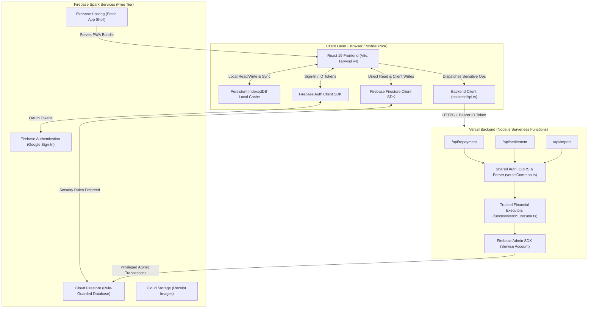

# Spenza — System Architecture

Spenza is a personal expense tracking Progressive Web Application (PWA). It is designed to run cost-effectively without monthly infrastructure charges by pairing **Firebase Spark** (Google's free tier) for client hosting, authentication, and database with **Vercel Hobby** (free tier) for secure server-side Node.js financial processing.

---

## 1. High-Level Architecture Overview



---

## 2. Component Layers & Responsibilities

### Frontend Layer (`src/`)

- **Framework & Bundler**: React 19, TypeScript 6, Vite 8.
- **Routing**: React Router 7 (`src/App.tsx`). All application features live under the protected `/app/*` path, guarded by `ProtectedRoute.tsx`.
- **Styling & Theming**: Tailwind CSS v4 (`@tailwindcss/vite`) combined with CSS design tokens in `src/index.css`. Theme state (Light vs. Dark) is managed by `src/hooks/useTheme.ts` and applies instantaneous theme attributes before render to prevent flash-of-unstyled-content (FOUC).
- **Feature Modules (`src/features/`)**:
  - `dashboard`: High-level monthly overview, 6-month net spending trends, payment breakdowns, and pacing projections.
  - `transactions`: Add/edit expense drawer, infinite scroll list, search, filters, and trip-bundle grouping.
  - `people`: Friends ledger, dues calculation, split partner onboarding, and bulk settlement.
  - `trips`: Dedicated travel expense management with budget tracking, day-by-day logs, and 5 spending buckets.
  - `recurring`: Subscription and EMI schedules with cross-app due prompts.
  - `budgets`: Overall and category-level monthly spending limits.
  - `insights`: 12-month analytics, month-over-month comparisons, and cached metrics.
  - `import`: Spreadsheet parsing (`SheetJS`), column detection, date review, and chunked upload dispatcher.
  - `settings`: Payment accounts management, data export/backup, and cache controls.
- **Persistence & Services (`src/services/`)**:
  - Encapsulates all Firestore queries, client-side mutations, and API invocations.
  - `src/services/backendApi.ts` serves as the single dispatcher for backend operations, transparently resolving whether to invoke Vercel HTTP endpoints in production/staging or Firebase callable functions when running locally against the emulator.
- **Pure Domain Calculations (`src/utils/`)**:
  - Pure, stateless financial mathematics: integer-paise conversions, split allocation remainder handling, recurring UTC date schedules, and CSV formatting.
  - Strictly separated from UI components and persistence drivers to ensure testability.

### Serverless Backend Layer (`api/` and `functions/src/`)

Spenza performs sensitive financial operations server-side to guarantee multi-document atomicity, idempotency, and data consistency:

1. **API Endpoints (`api/`)**:
   - `api/repayment.ts` (`POST /api/repayment`): Records split repayments and updates personal dues.
   - `api/settlement.ts` (`POST /api/settlement`): Settles outstanding balances in bulk or per transaction with concurrency fencing.
   - `api/import.ts` (`POST /api/import`): Commits chunked spreadsheet rows with server-verified validation cursors and receipts.
2. **Vercel Handlers (`functions/src/vercel*.ts`)**:
   - HTTP request parsing, payload size caps (64 KB limit), CORS preflight headers, and Firebase ID token extraction via `vercelCommon.ts`.
   - Translates domain errors into consistent JSON responses and maps HTTP status codes to standard error codes.
3. **Trusted Financial Executors (`functions/src/*Executor.ts`)**:
   - Pure, environment-agnostic business logic.
   - Operates directly via the Firebase Admin SDK (`firebase-admin/firestore`).
   - Reused across both Vercel serverless adapters and local Firebase emulator callable functions.

### Firebase Services Layer

1. **Firebase Authentication**:
   - Google Sign-In provides identity.
   - All user data in Firestore is partitioned strictly under `users/{uid}/`.
2. **Cloud Firestore**:
   - NoSQL document store configured with `persistentLocalCache` and `persistentMultipleTabManager`.
   - Guarded by server-side `firestore.rules` that enforce schema validity, UID ownership, and read-only protections on server-owned receipts and settlement logs.
3. **Firebase Storage**:
   - Storage bucket provisioned for optional receipt image uploads under `users/{uid}/receipts/`.

---

## 3. Data Flow & Communication Patterns

### Standard Client Operations (Read / Everyday Writes)

```
[ User Action ]
      │
      ▼
[ React Component ] ──► [ Service Function (e.g. transactions.ts) ]
                               │
                               ▼
                    [ Firestore Client SDK ]
                               │
                ┌──────────────┴──────────────┐
                ▼                             ▼
       [ IndexedDB Local Cache ]     [ Cloud Firestore ]
         (Immediate UI update)      (Network synchronization)
```

- Standard personal expenses, category updates, and trip metadata are written directly by the client SDK.
- Firestore security rules validate that the write targets `users/{request.auth.uid}/...`, enforces integer-paise fields, and validates payment mode constraints.
- Changes are committed to local IndexedDB immediately, enabling offline operation and multi-tab synchronization.

### Sensitive Financial Operations (Repayment, Settlement, Import)

```
[ User Action ]
      │
      ▼
[ React Component ] ──► [ backendApi.ts ]
                               │
                               ├─► 1. Fetches Firebase ID Token (user.getIdToken())
                               ├─► 2. Serializes payload with Idempotency Key
                               ▼
                 [ HTTPS POST /api/* to Vercel ]
                               │
                               ├─► 3. Verifies ID Token via Firebase Admin
                               ├─► 4. Extracts verified UID (rejects client-supplied UID)
                               ├─► 5. Executes Firestore RunTransaction with Fencing
                               ▼
                  [ Cloud Firestore Documents ]
             (Ledgers, Receipts, Invalidation Markers)
                               │
                               ▼
                    [ HTTP 200 OK Response ]
                               │
                               ▼
           [ Client UI updates & Cross-Tab Invalidation ]
```

- The client **never** updates split balances, settlement receipts, or imported transactions directly.
- The Vercel function extracts the user identity directly from the cryptographically verified JWT token. Tampering with client payloads (such as IDOR attacks supplying a different UID) is rejected with HTTP 403 Forbidden.
- Operations run inside atomic Firestore transactions. If two settlement requests occur concurrently, concurrency leases and fencing tokens guarantee only one succeeds while the duplicate replays the existing receipt.

---

## 4. Local Emulator Compatibility

Although production runs on Vercel without Cloud Functions, the repository maintains complete compatibility with the local Firebase Emulator Suite:

- `functions/src/index.ts` exports callable wrappers (`executeRepaymentV1`, `executeSettlementV1`, `executeImportV2`) around the same pure executors.
- When running in development with `VITE_USE_FIREBASE_EMULATOR=true`, `src/services/backendApi.ts` detects emulator mode and dispatches directly to the local Functions emulator port (`5001`), allowing fully offline development without any live cloud services or Vercel deployment.
